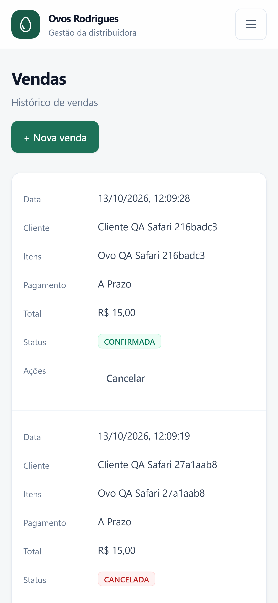
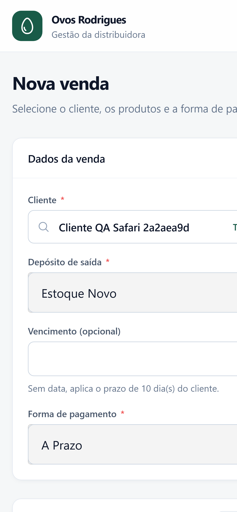

# Filipe Silva Rodrigues 👋

**Desenvolvimento de Software • Sistemas Empresariais • Banco de Dados**

📍 Franca, SP &nbsp; | &nbsp; 🎓 Ciência da Computação — UNIFRAN (previsão: 2028)

---

## 👨‍💻 Sobre mim

Sou estudante de **Ciência da Computação na Universidade de Franca (UNIFRAN)**, com previsão de conclusão em **2028**. Meu interesse está em desenvolver software que resolva problemas reais, especialmente sistemas de gestão, aplicações web e soluções orientadas a dados.

Tenho experiência anterior com **suporte a sistemas corporativos, SQL, operações em banco de dados e planilhas eletrônicas**. Em paralelo à graduação, desenvolvo projetos próprios e acadêmicos, aplicando conceitos de frontend, backend, bancos de dados, testes e organização de código.

## 🛠️ Tecnologias

**Linguagens**

**Desenvolvimento e dados**

**Ferramentas**

---

## 🚀 Projeto em destaque — ERP Ovos Rodrigues

**Sistema de gestão para uma distribuidora de ovos**, desenvolvido para apoiar a operação de um negócio real. O projeto reúne processos comerciais, controle de estoque e acompanhamento financeiro em uma aplicação web.

**Principais funcionalidades:**

- **Vendas e compras:** registro de operações, clientes, fornecedores e formas de pagamento.
- **Estoque:** produtos, conversão de unidades e movimentações entre depósitos.
- **Financeiro:** contas a pagar e receber, despesas e indicadores.
- **Dashboard:** visão geral de vendas, resultados e estoque.
- **Experiência mobile:** interface responsiva com validações em navegadores móveis.

**Stack do projeto atual:** React, TypeScript, Vite, Tailwind CSS, Fastify, Prisma e PostgreSQL. Inclui testes automatizados e validações para navegação mobile.

### Telas do sistema

  <table>
    <tr>
      <td align="center"><strong>Histórico de vendas — mobile</strong></td>
      <td align="center"><strong>Cadastro de venda — mobile</strong></td>
    </tr>
    <tr>
      <td align="center"></td>
      <td align="center"></td>
    </tr>
  </table>
  Imagens de testes de interface com dados de demonstração, sem informações financeiras operacionais reais.

> 🔒 A versão atual do ERP é mantida em repositório privado. O [protótipo público anterior](https://github.com/Filipesilva10/ovos-rodrigues) pode ser consultado separadamente.

### Outros projetos

| Projeto | Descrição | Foco |
| :--- | :--- | :--- |
| [🧠 Tradutor de Lógica Proposicional](https://github.com/Filipesilva10/Trabalho-Traduzindo-CPC-Para-LN) | Tradução entre linguagem natural e lógica proposicional. | Lógica e desenvolvimento web |
| [📦 Cognato](https://github.com/Filipesilva10/cognato) | Projeto de aplicativo web voltado a controle de estoque. | PWA e aplicações web |
| [🧩 Estruturas de Dados](https://github.com/Filipesilva10/Estruturas-de-dados-) | Atividades e implementações acadêmicas. | Algoritmos e estruturas de dados |
| [🗄️ Exercícios SQL](https://github.com/Filipesilva10/Exercicios_SQL) | Exercícios relacionados a consultas e manipulação de dados. | SQL e bancos de dados |

---

## 💼 Experiência profissional

**Carmistefanis — Suporte a Sistemas e Banco de Dados (experiência anterior)**

- Suporte a usuários de sistema corporativo e análise de dificuldades operacionais.
- Consultas e operações em bancos de dados utilizando **SQL**.
- Uso de **planilhas eletrônicas** para organização, controle e acompanhamento de informações.
- Investigação de inconsistências e apoio à resolução de problemas.

---

## 🎓 Formação e certificações

- **Ciência da Computação — Universidade de Franca (UNIFRAN)** · conclusão prevista para **2028**.
- **Networking Basics (Conceitos Básicos de Redes)** — Cisco Networking Academy · setembro de 2026.
- **Getting Started with Cisco Packet Tracer** — Cisco Networking Academy · setembro de 2026.

## 📚 Atualmente estudando

| Área | Objetivo |
| :--- | :--- |
| Desenvolvimento de software | Frontend, backend, APIs e boas práticas |
| Bancos de dados | SQL, modelagem de dados e integração com aplicações |
| Estruturas de dados | Algoritmos e resolução de problemas |
| Redes de computadores | Protocolos, conectividade e simulação de redes |
| Qualidade de software | Testes automatizados e manutenção de sistemas |

## 📊 GitHub

## 📬 Contato

- **GitHub:** [@Filipesilva10](https://github.com/Filipesilva10)

---

<i>Desenvolver software é transformar necessidades reais em soluções úteis.</i>

